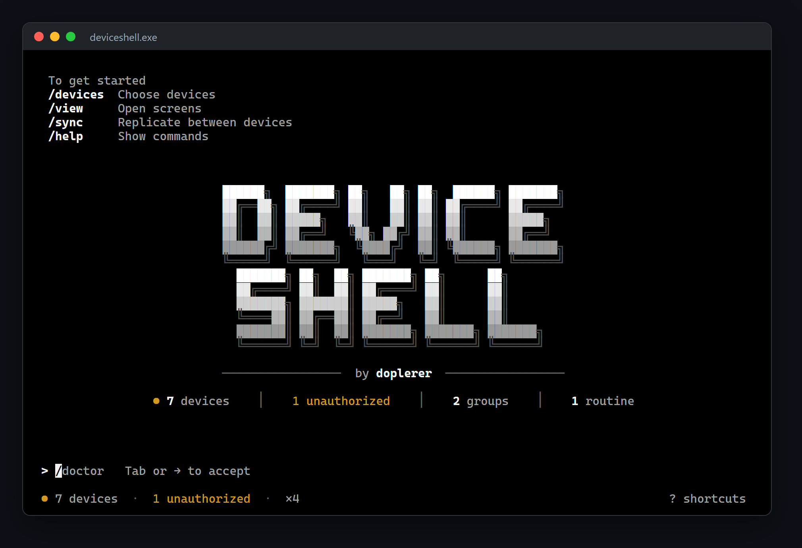
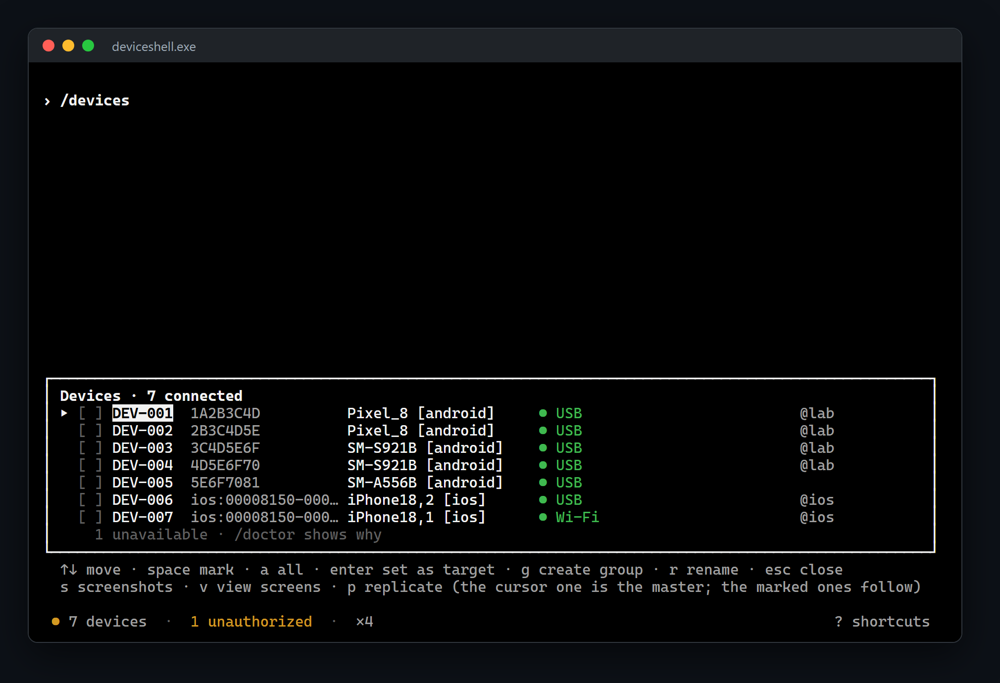

# DeviceShell

[](https://github.com/doplerer/DeviceShell/actions/workflows/ci.yml)
[](https://github.com/doplerer/DeviceShell/releases/latest)
[](LICENSE)


**Control dozens of Android phones and iPhones from one Windows PC.** DeviceShell is a
portable command-line and terminal application for device labs and test benches: it keeps
an inventory of every connected device, runs actions on many of them in parallel, shows
their screens live in a window wall and replays your gestures from one phone to all the
others in real time.

<p align="center">
  
</p>

It is a single executable with no installer. Android support uses ADB and scrcpy;
iPhones and iPads are controlled without an Apple account, Xcode, a Mac or any app
installed on the phone.

## Features

- **Inventory and health.** Every device gets a stable alias (`DEV-001`, `DEV-002`…) and
  can be organized in groups. `doctor` reports battery, temperature, storage, memory,
  network and screen state, raises alerts, and warns when too many phones share one USB
  controller.
- **Batch actions.** Tap, swipe, type text, press keys, open URLs, install and uninstall
  apps (including split APKs), start/stop/clear apps, push and pull files, grant
  permissions, change settings, rotate, set the resolution, reboot, take screenshots,
  record the screen, read logcat or run shell commands, on one device, a group or all of
  them. Batches run in parallel, keep going when a device fails, write a report and can
  retry only the failures.
- **Routines.** Replayable JSON step sequences with parameters, per-step retries,
  timeouts and error handling, limited to Android, iOS or both.
- **Screen wall.** Live video of every device in its own window at up to 60 fps, laid out
  in a grid across one or several monitors. Windows can be used to control each device
  or opened read-only, and reopen themselves if a stream drops. Built to handle 200+
  windows.
- **Live replica.** Use one device as the master and every follower repeats your touches
  and keys in real time, mixing Android and iPhone. Resolutions are matched for the
  duration of the session so taps land on the same buttons.
- **iPhone and iPad without signing.** DeviceShell opens its own CoreDevice tunnel over
  USB, asks the phone to trust the PC, turns on Developer Mode and mounts the developer
  disk image automatically. After one USB connection, iPhones also work over Wi-Fi.
  Video comes from DisplayService or, optionally, from the QuickTime USB capture.
- **Two interfaces.** A scriptable CLI where every command has `--json` output, and an
  interactive terminal interface with a command palette, a step-by-step form for missing
  arguments, panels for devices, jobs and replicas, and a settings screen. English and
  Spanish.

<p align="center">
  
</p>

## Requirements

- Windows 10 or 11, x64.
- **Android:** USB debugging enabled on each device (ADB over Wi-Fi also works).
- **iPhone/iPad:** iOS 27 or later, connected by USB at least once. Internet access the
  first time, to download Apple's developer disk image.
- For many devices, spread them over several USB host controllers; `doctor` shows how
  they are distributed.

## Getting started

1. Download `deviceshell-<version>-windows-amd64.zip` from the
   [latest release](https://github.com/doplerer/DeviceShell/releases/latest) and extract
   it anywhere. It already includes ADB, scrcpy and FFmpeg.
2. Connect your devices and accept the debugging prompt on each Android phone.
3. Open a terminal in that folder:

```powershell
.\deviceshell.exe devices          # detect devices and assign aliases
.\deviceshell.exe doctor           # health check of the PC and every device
.\deviceshell.exe group create lab --devices DEV-001,DEV-002
.\deviceshell.exe screenshot --group lab
.\deviceshell.exe view --all       # open the screen wall
.\deviceshell.exe sync start --master DEV-001 --all   # replicate DEV-001 on the others
```

Run `deviceshell.exe` without arguments, or double-click it, to open the interactive
interface; type `/help` for the commands and `/settings` to change the language,
concurrency, window area and alerts. Actions always need an explicit target
(`--devices`, `--group` or `--all`), so nothing runs on every device by accident.

## Documentation

| Guide | Contents |
|---|---|
| [Command-line and interface guide](docs/cli.md) | Every command, targets, batches, routines, screen wall, live replica, settings, data retention and reset. |
| [iPhone guide](docs/iphone.md) | Preparing iPhones and iPads, Wi-Fi, video sources, the QuickTime driver and troubleshooting. |
| [iPhone protocol notes](docs/iphone-protocol.md) | How the CoreDevice tunnel, DisplayService, HID and RemotePairing are used. |
| [Development guide](docs/development.md) | Architecture, building, tests with real devices and performance measurement. |
| [Changelog](CHANGELOG.md) | What changed in each version. |

## Building from source

```powershell
git clone https://github.com/doplerer/DeviceShell.git
cd DeviceShell
powershell -NoProfile -ExecutionPolicy Bypass -File .\scripts\build.ps1
powershell -NoProfile -ExecutionPolicy Bypass -File .\scripts\fetch-tools.ps1
.\dist\deviceshell.exe --help
```

`build.ps1` downloads the pinned Go toolchain into `.toolchain/` on first use, runs
`gofmt`, `go vet` and the tests, builds offline from `vendor/` and installs the
executable into `dist/` (add `-ValidateOnly` to stop after the checks).
`fetch-tools.ps1` downloads the pinned scrcpy release (ADB, scrcpy-server and FFmpeg)
into `dist/tools/` and verifies its checksum. See [CONTRIBUTING.md](CONTRIBUTING.md) for
the workflow.

## Repository layout

| Path | Contents |
|---|---|
| `cmd/deviceshell/` | Executable entry point. |
| `internal/core/` | Service: inventory, groups, batches, routines, health, screen wall, replica and video windows. |
| `internal/cli/`, `internal/tui/` | Cobra commands and the Bubble Tea interface. |
| `internal/android/` | ADB server protocol (`adb`) and scrcpy-server wire format (`scrcpy`). |
| `internal/ios/` | CoreDevice tunnel (`coredevice`), Wi-Fi pairing (`remotepairing`), QuickTime capture (`quicktime`) and its WinUSB driver installer (`qtdriver`). |
| `internal/filelock/`, `internal/procstat/`, `internal/usb/`, `internal/i18n/` | System utilities and language handling. |
| `configs/` | Template `config.json` and the routines copied into new installations. |
| `scripts/` | Build, tool download and the pinned toolchain version. |
| `docs/` | User and developer guides; `docs/research/` keeps measurements. |
| `vendor/` | Vendored Go dependencies for offline builds. |

An installation is any folder with `deviceshell.exe` and `config.json`. It keeps its data
next to the executable: `data/` (inventory, groups, history), `routines/`, `output/`
(screenshots, downloads, logcat and logs) and `tools/`. Installations created by earlier
versions, released as BOTFARM, are migrated automatically on first start.

## Responsible use

DeviceShell is meant for devices you own or are authorized to manage: QA and test labs,
app development, demos and device administration. Respect the terms of service of the
apps and platforms you automate.

## License

DeviceShell is released under the [MIT License](LICENSE). Third-party code and tools keep
their own licenses; see [THIRD_PARTY_NOTICES.md](THIRD_PARTY_NOTICES.md).

DeviceShell is not affiliated with, endorsed by or sponsored by Apple or Google. iPhone,
iPad and iOS are trademarks of Apple Inc.; Android is a trademark of Google LLC.
